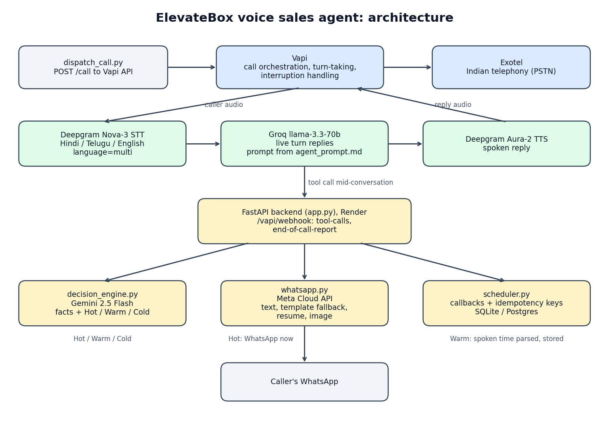

# ElevateBox voice sales agent

An outbound voice agent built for ElevateBox's (ElevateScale Technologies)
SDE Intern assignment. It calls a lead, pitches e-commerce website
development in Hindi, Telugu or English, classifies the lead Hot, Warm or
Cold as the conversation goes, sends a WhatsApp while the call is still live
when intent is high, books a callback from a spoken time, and sends a
post-call WhatsApp with the real context of the conversation, a resume, a
phone number and an architecture image.



## Verification status (read this first)

Stated as of 2026-10-13. Nothing is claimed that has not been run.

| Area | Status | Evidence |
|---|---|---|
| Backend deployed | Verified | https://elevatebox-voice-agent-zeaa.onrender.com `/health` |
| Webhook logic (tool calls, end of call, idempotency, secret check) | Verified with simulated payloads | `tests/test_webhooks.py`, 27 tests in `tests/` |
| WhatsApp client (retry, template fallback) | Verified against a mocked Meta API only | `tests/test_whatsapp.py` |
| Gemini classification | Verified live on synthetic transcripts | `docs/classification_eval.md` |
| Prompt behaviour | Text simulation only, not voice | `docs/stress_results_baseline.md`, `docs/prompt_changelog.md` |
| Vapi assistant | Created and updated through the real API | `vapi_setup.py` |
| A real phone call | **Not yet done** | Needs an Exotel ExoPhone (KYC) |
| A real WhatsApp delivery | **Not yet done** | Needs a Meta access token and payment method |
| Approved WhatsApp templates | **Not yet submitted** | `docs/whatsapp_templates.md` |
| STT accuracy on real speech | **Not measured** | harness in `tools/stt_tts_compare.py` |
| Hindi and Telugu speech quality | **Weak** with the current voices | `docs/stt_tts_comparison.md` |

## How it works

1. `dispatch_call.py` asks Vapi to place an outbound call through the
   Exotel-backed number.
2. Vapi runs the live loop: Deepgram Nova-3 transcribes, a Groq model
   replies from the prompt in `agent_prompt.md`, Deepgram Aura-2 speaks.
   Vapi handles turn-taking and interruption (barge-in); the stop plan is
   set in `vapi_setup.py`. This service does not touch the audio.
3. When the model calls a tool, Vapi POSTs to `/vapi/webhook`
   (`tool-calls`):
   - `extract_and_classify`: `decision_engine.py` (Gemini) extracts budget,
     product, catalog size, timeline and features, and returns Hot, Warm or
     Cold. On the first Hot, a WhatsApp goes out immediately.
   - `schedule_callback`: the spoken time is resolved to a datetime and
     stored in `scheduler.py`.
4. When the call ends, Vapi POSTs `end-of-call-report`. The service sends the
   post-call WhatsApp (text, resume, architecture image).

Reliability behaviour:

- A repeated tool call (same `toolCallId`) returns the stored result and
  does not send a second WhatsApp.
- The end-of-call report is processed once per call id, and a failed send is
  not marked processed, so a retry can try again.
- WhatsApp sends retry on 429 and 5xx with backoff, never on other 4xx.
- Outside the 24-hour window, a free-form send is rejected by Meta (error
  131047) and the code falls back to an approved template.
- Callbacks and idempotency keys use Postgres when `DATABASE_URL` is set and
  SQLite otherwise.
- Every step logs one JSON line with the call id.
- If `WEBHOOK_SECRET` is set, requests without the matching `X-Vapi-Secret`
  header get 401.

## Stack

Vapi (orchestration), Exotel (telephony), Deepgram Nova-3 (STT) and Aura-2
(TTS), Groq (live replies, model set by `GROQ_MODEL`, default
`openai/gpt-oss-120b`), Gemini 2.5 Flash (classification and time parsing),
Meta WhatsApp Cloud API, FastAPI, SQLite or Postgres, deployed on Render.

Two earlier builds are kept for reference with notes on why they were
abandoned: `omnidimension_reference/` and `google_twilio_reference/`.

## Setup

```bash
pip install -r requirements.txt
cp .env.example .env        # fill in the values, never commit .env
pip install -r requirements-dev.txt
pytest                      # 27 tests, no network or keys needed
uvicorn app:app --port 8000
python vapi_setup.py        # create/update the assistant, copy the id into .env
python dispatch_call.py +91XXXXXXXXXX
python tools/fetch_call.py <call_id> --label "Hindi hot lead"
```

Accounts only the owner can create: Exotel KYC and an ExoPhone
(`EXOTEL_EXOPHONE`), Meta WhatsApp access token and payment method
(`META_WA_ACCESS_TOKEN`), and template approvals
(`docs/whatsapp_templates.md`).

## Repository map

- `app.py`: FastAPI webhooks. `messages.py`: WhatsApp text. `whatsapp.py`:
  Meta client. `decision_engine.py`: Gemini extraction and classification.
  `scheduler.py`: callbacks and idempotency store.
- `agent_prompt.md`: the conversation design and rules, the source of the
  system prompt built in `vapi_setup.py`.
- `tools/`: `make_architecture.py`, `stress_text.py`, `classification_eval.py`,
  `stt_tts_compare.py`, `fetch_call.py`.
- `docs/`: evaluation reports, `prompt_changelog.md`, `whatsapp_templates.md`,
  `test_calls/` (artifacts of real calls, empty until a call is made).
- `tests/`: pytest suite.

## Known limitations

- No real call or real WhatsApp delivery has happened yet (see status table).
- The Vapi webhook field names were written from the spec and exercised with
  simulated payloads. A real call may reveal differences.
- The Aura-2 voices are English voices. Hindi and Telugu replies are only
  partly intelligible (see `docs/stt_tts_comparison.md`). A provider with
  real Hindi and Telugu voices is needed before claiming those languages
  work on a call.
- The Groq key on this project is limited to 8,000 tokens per minute per
  model, and the prompt is re-sent every turn. A fast conversation with tool
  calls can hit that cap. The runtime prompt is trimmed to the sections the
  live model needs and replies are capped at 200 tokens, but a paid or dev
  tier is the real fix for a live demo.
- Stress results are from a text simulation graded by an LLM, not from
  voice calls, and the synthetic classification set is not real call data.
- Attachments (resume, image) are free-form and deliver only inside an open
  24-hour WhatsApp window.
- `WEBHOOK_SECRET` is supported by the code but is only enforced once it is
  set both here and on the assistant.
- Render's free tier sleeps when idle, so the first webhook after a quiet
  period can be slow. Set `DATABASE_URL` to keep callbacks across restarts.
- A Groq model name may be retired, as the previous one
  (`llama-3.3-70b-versatile`) was. Override with `GROQ_MODEL` and re-run
  `vapi_setup.py`.

## Submitting to ElevateBox

Per the brief, WhatsApp 8688664337 with the working prototype, the
architecture diagram (`architecture.png`), a note under 200 words, the
resume, the mobile number and the repo link. Do not send a deck or a demo
video in place of a live call.
